<div align="center">

<a href="https://seaflooratlas.org/">
  <picture>
    <source media="(prefers-color-scheme: dark)" srcset="docs/img/brand/seafloor-atlas-logo-dark.svg">
    
  </picture>
</a>

**An interactive 3D globe of the whole ocean floor, and how much of it has actually been measured.**

Built from open data: the shape of the seafloor, which 30.8 % ships have surveyed, how sure we are of the rest,
the water above it, the life in it and what people have built on it.

[**seaflooratlas.org**](https://seaflooratlas.org/) · runs in the browser, no server, no cookies

[](https://doi.org/10.5281/zenodo.24228190)

</div>

<a href="https://seaflooratlas.org/">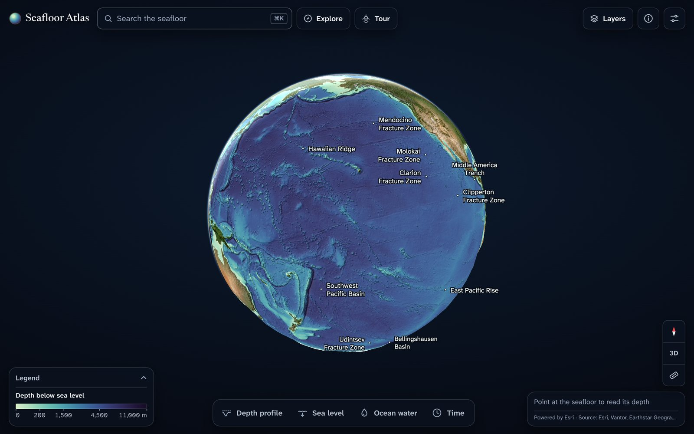</a>

New here? Press **Tour**: Ping, a small sonar buoy, walks you through the atlas in 15 short chapters. It moves the camera, switches the layers on and points at each control as it explains it. Every number it quotes comes from the data, with the source underneath. Start at any chapter with `#tour=N`. The tour also speaks Uzbek: it switches by itself in an Uzbek browser, or add `&lang=uz`.

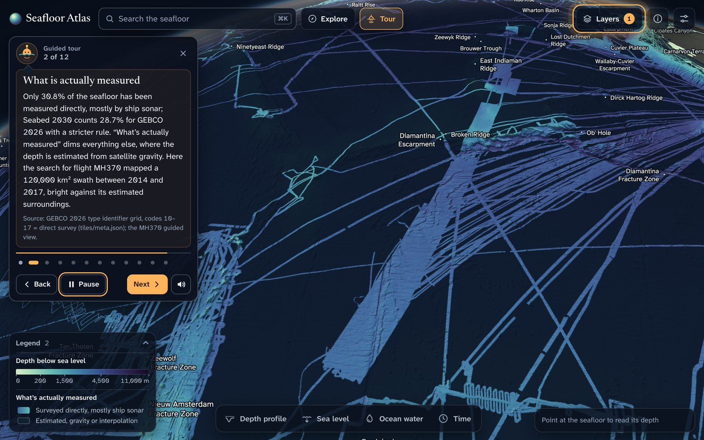

## What you can do

| | |
|---|---|
| 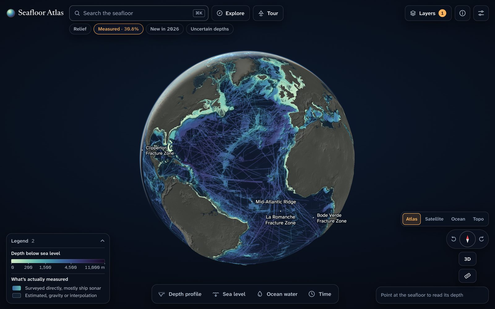 **What's actually measured.** Switch it on: only seafloor surveyed by ships stays bright, the satellite estimate goes dark. | 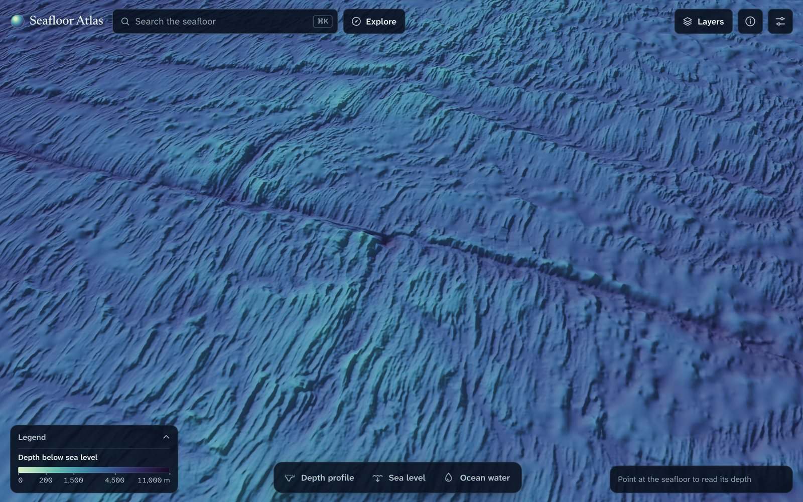 **Zoom to 460 m detail.** Zoom 6–7 stream the full 15″ GEBCO grid (Mid-Atlantic Ridge fracture zone shown). |
| 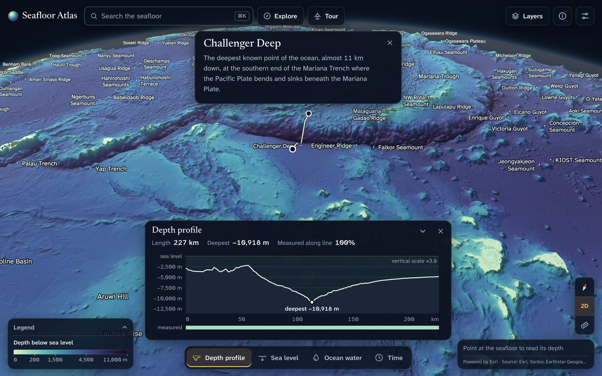 **Depth profile.** Click two points; the line across Challenger Deep reaches −10,918 m. | 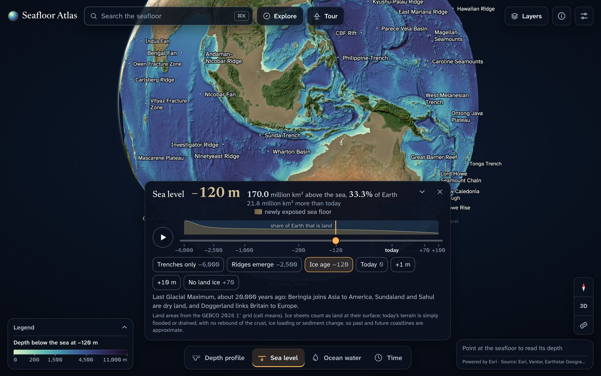 **Change sea level.** At −120 m (last ice age) Sundaland and Sahul are dry land: 21.8 million km² more land. |
| 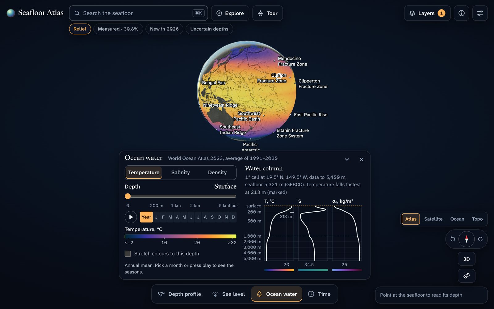 **Ocean water.** Temperature, salinity and density from the surface to 5 km, monthly animation, water-column chart where you click. | 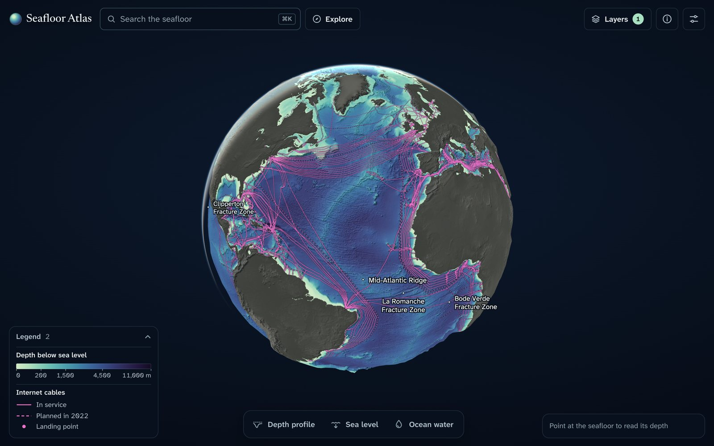 **Human activity.** Internet cables, shipping traffic, shipwrecks, oil and gas platforms, pipelines, wind farms. |
| 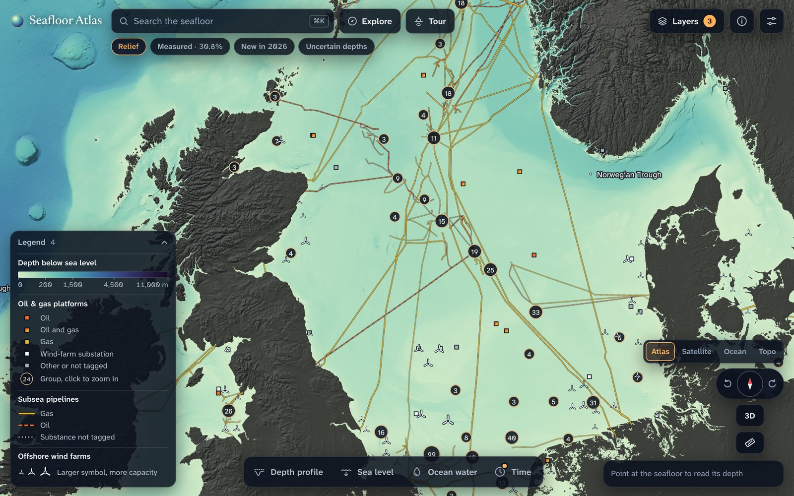 **Click anything** for a card: the Titanic wreck, the MAREA cable, Troll A, Nord Stream 1, Hornsea 1. | 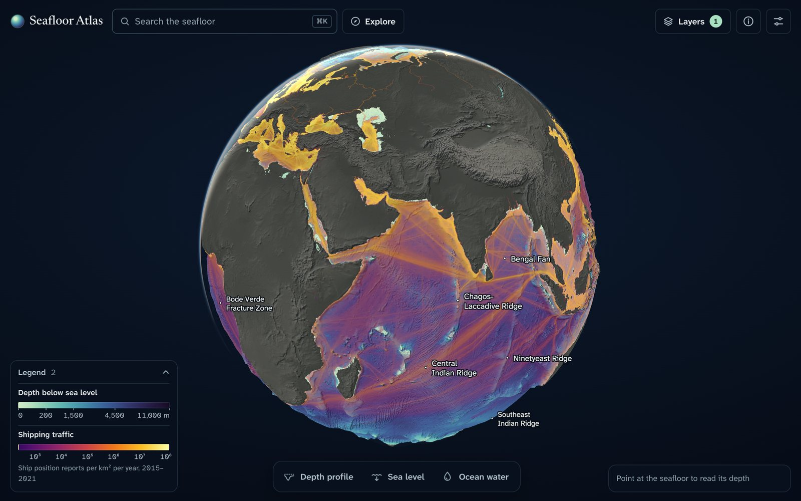 **Shipping density** from AIS 2015–2021: the world's sea lanes. |
| 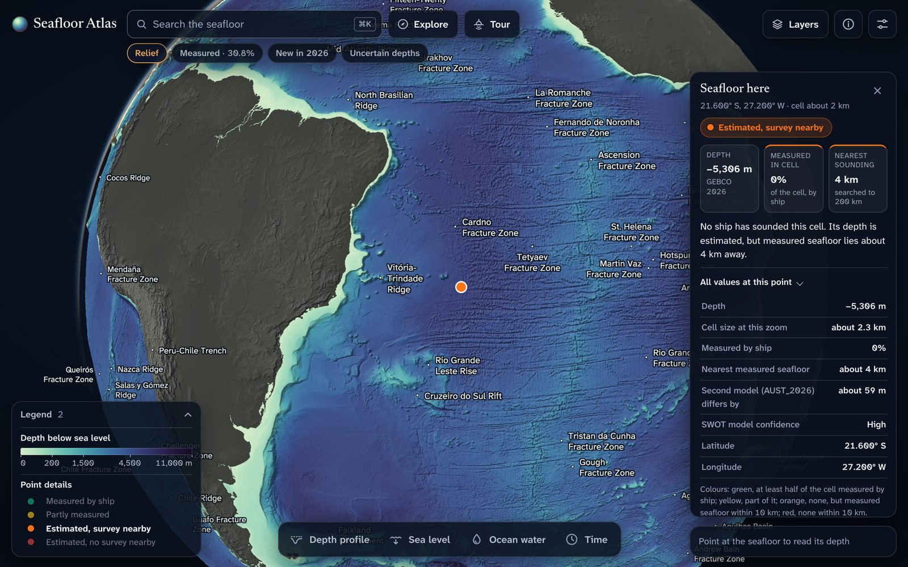 **Click the seafloor** for point details: a status badge (measured by ship, partly measured, estimated with a survey within 10 km, estimated with none), depth, the measured share of the cell, the nearest sounding within 200 km and the full table of values. The same four colours mark the point on the map and in the legend. On a phone it opens as a bottom sheet. | 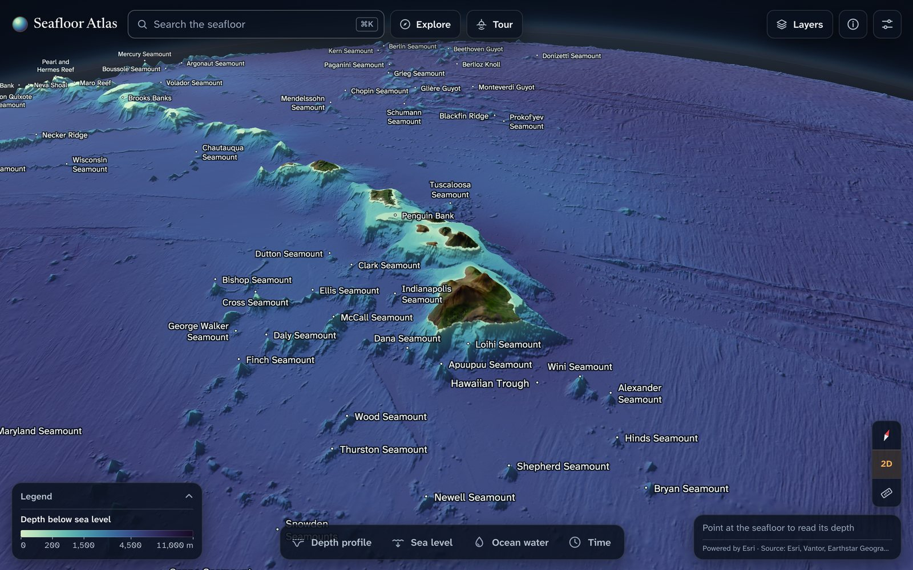 **Satellite land, measured ocean.** Land comes from Esri World Imagery while the seafloor keeps the GEBCO 2026 relief colours (Hawaiʻi shown). Switch Satellite land off under Layers for plain grey land and no requests to Esri; `#land=grey` links that view. |
| 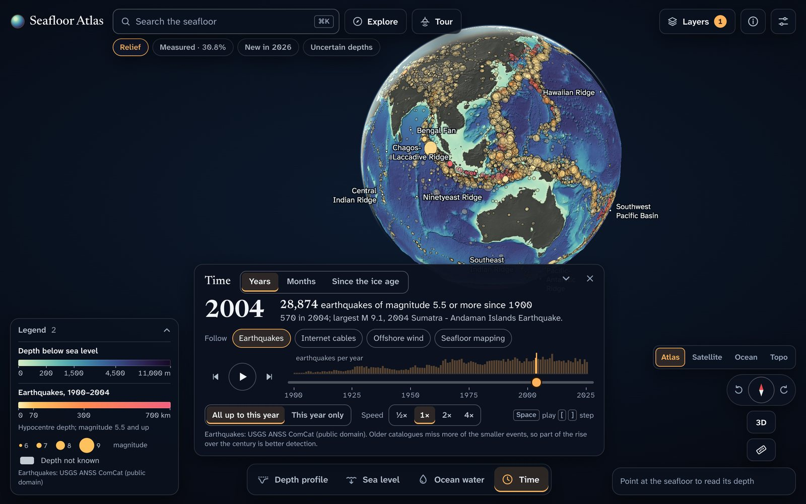 **Time.** Play earthquakes since 1900, cables, wind farms or seafloor mapping 2019→2026 year by year (2004: the M 9.1 Sumatra quake). | 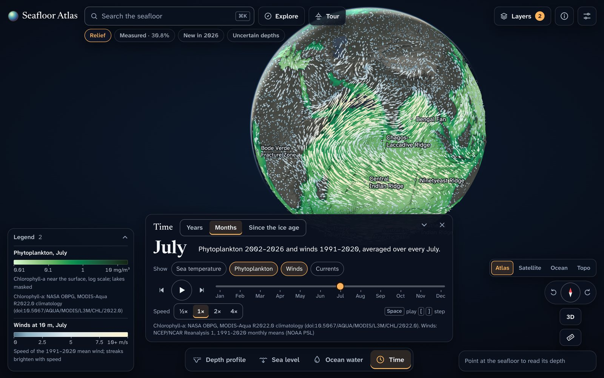 **Months.** Winds, currents, phytoplankton and sea temperature through the year: in July the monsoon blows from the SW and the Arabian Sea blooms. |

Also: 11 guided views, search over 5,412 named undersea features, cables and wrecks (⌘K), plate boundaries, model disagreement, prediction confidence, seal soundings and marine life (AquaMaps model, sampling-corrected diversity, data gaps, how completely each hexagon's species are known; a click opens [Fauna Atlas](https://fauna.bristleconelab.org) for every animal recorded there), deep links for every view (`#story=`, `#sea=`, `#water=`, `#layers=`, `#time=`, `#tour=`, `#land=grey`).

New layers and the Time panel:

* **Earthquakes**: every M ≥ 5.5 since 1900 (USGS ComCat, 39,650 events) sized by magnitude and coloured by depth, or the live USGS feed of the last 30 days; click for place, time, depth and the USGS event page.
* **Seamounts**: 69,770 from two satellite-gravity catalogues; filled when a sonar sounding sits on the summit (34.2 %), an open ring when the summit depth is only predicted.
* **Phytoplankton** (MODIS-Aqua chlorophyll-a, lakes masked), **Winds** and **Ocean currents** as moving streaks that follow the globe; point anywhere for speed and direction.
* **Ocean water at the seafloor**: the depth slider's last stop shows the deepest measured water in each cell (WOA23): potential temperature θ, salinity and density σ₄. Antarctic Bottom Water below 0 °C (−0.94 °C on the Weddell abyssal plain) spreads north through the western Atlantic basins (0.15 °C in the Brazil Basin, 1.95 °C in the Canary Basin). `#water=t-bottom`.
* **Overturning at 26.5° N (AMOC)**: the RAPID mooring line across the Atlantic and its measured record since April 2004 (mean 17.1 Sv, 1.22 PW of heat northward): warm water north in the top 1,100 m, deep water back south, Antarctic Bottom Water north along the floor. Click the line for the monthly chart. `#layers=amoc`.
* **Time** (tool bar): *Years* plays earthquakes, internet cables, offshore wind farms or **seafloor mapping 2019→2026** (each GEBCO release lit up, our measured share next to the official Seabed 2030 figure); *Months* runs sea temperature, phytoplankton, winds and currents through the seasons together (the Indian monsoon and the Arabian Sea bloom in July); *Since the ice age* lowers the sea to the Last Glacial Maximum (−134 m, 20,500 years ago) and lets it rise to today.
* A **compass and 3D switch** above the depth readout: the needle shows north (click to turn north up), the arrows rotate the map by 45°, **3D** tilts the camera and **2D** flattens it again.
* **Measure distance**, as on Google Maps: the ruler under the compass, or right-click the globe. Click to add points along great circles, drag a point to move it, click a point to remove it, click the first point to close the shape and see its area. Distances in km and miles on the mean-radius sphere (within about 0.5 % of WGS84).
* A slim **loading bar** at the bottom while map detail streams in; **OpenStreetMap cables** as a supplement to the 2022 cable snapshot.

## Key numbers

| | |
|---|---|
| Ocean area | **361.7 million km²** (70.9 % of Earth) |
| Seafloor directly measured (ship sonar, lidar, …) | **30.8 %** (official Seabed 2030 figure: 28.7 %, stricter rule) |
| Measured in GEBCO_2025 → GEBCO_2026 | 29.7 % → 30.8 %, **+4.1 million km²** in a year |
| National waters (EEZs) vs high seas measured | **38.0 %** vs **26.4 %** |
| 14 deepest places: median error of the 15″ grid vs published surveys | **10 m** (354 m on a 10 km grid) |
| Ocean volume, mean depth | **1.338 billion km³**, **3,702 m** (Charette & Smith 2010: 1.332, 3,682) |
| Where two global seafloor models disagree (unmeasured, > 1 km deep) | median **60 m**, 35 % of the area > 100 m |
| Seal dives deeper than the chart allows (Southern Ocean) | **2.2 %** of 4.5 million dives |
| Ocean area with no species record at all (~39 × 20 km cells) | **45 %** |

All numbers are computed in this repository from the data listed below, area-weighted on the sphere.

**Agrees with earlier work.** Niyazi et al. (2025, *Frontiers in Marine Science*, doi:10.3389/fmars.2025.1543885) measured the same thing from the 2019–2024 grids and got 12.4 % for 2019 and 28.5 % for 2024. This repository gets 12.43 % and 28.54 %. What it adds: the area that drops out of "measured" between releases (0.8–4.6 million km² each time), the share measured in at least one release (33.0 %), the 2025 and 2026 grids, and code you can rerun.

**Dataset.** The cell-level record behind these numbers (netCDF, 15″, per-release measured bitmask, first/last measured release, re-coded and inland flags, plus tidy CSV tables) is archived on Zenodo: [doi:10.5281/zenodo.24287579](https://doi.org/10.5281/zenodo.24287579) (CC BY 4.0). It is built by `pipeline/build_dataset.py`.

**The cell size matters.** A 15″ cell is 463 m wide at the equator but only 80 m at 80°. On blocks of the same width everywhere, the share barely moves (31.1 %) and the Arctic stays the least measured. But if one sounding is allowed to count for a whole block, the share grows with the block: 33.5 % on ~0.9 km blocks, 37.7 % on ~1.9 km. So coverage numbers can only be compared at a stated cell size. Details: [docs/sensitivity_cellsize.md](docs/sensitivity_cellsize.md).

## What the data shows

### Less than a third of the seafloor has been measured

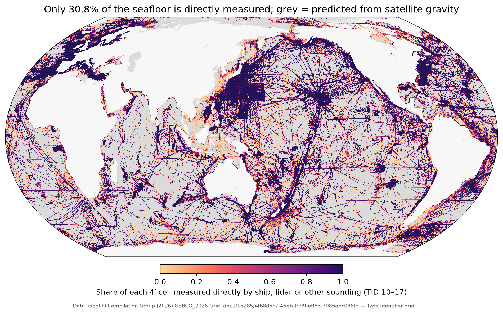

Dark lines are single ship tracks; solid areas are full multibeam surveys. Everything grey has never been reached by sonar: its depth is predicted from tiny bumps in sea-surface gravity measured by satellites, which resolve only features a few kilometres across.

### Mapping, release by release

| Measured share per GEBCO release | How it was measured |
|---|---|
| 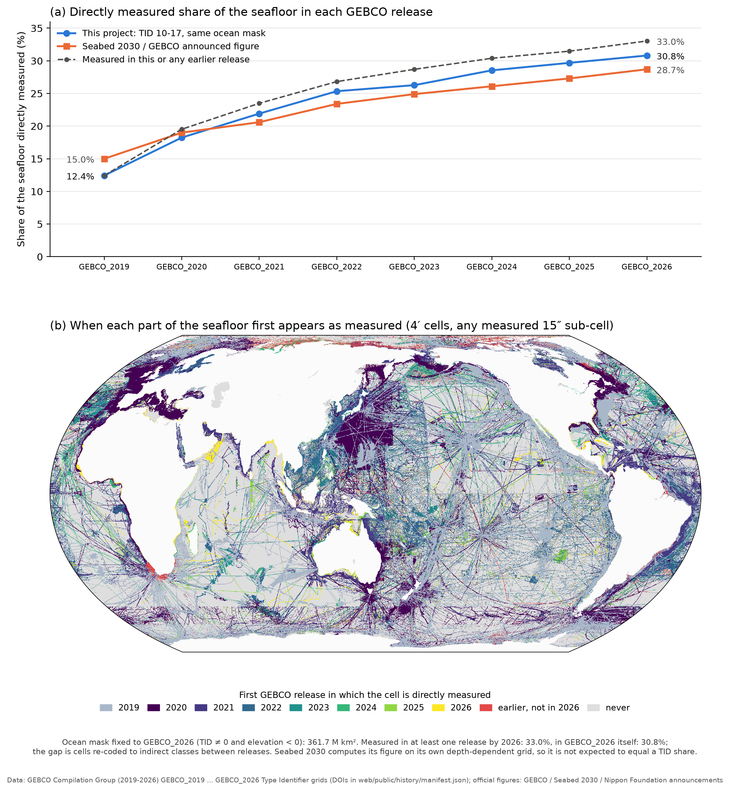 | 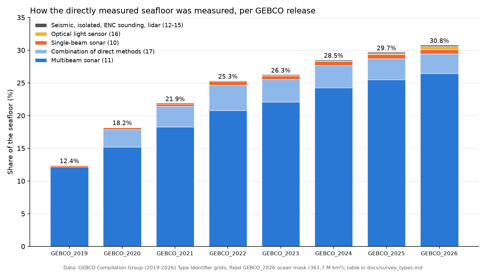 |

The measured share grew from 12.4 % in GEBCO_2019 to 30.8 % in GEBCO_2026, but it is not a running total: 33.0 % was measured in at least one release. Multibeam sonar is 26.4 % of the seafloor in 2026 and carries almost all of the growth; 3.0 % is coded as a combination of direct methods (a code first used in 2020) and 0.6 % as single-beam. Table: [docs/survey_types.md](docs/survey_types.md).

### The deepest places are the best known; the average seafloor is the least known


74 % of the ocean floor lies 3–6 km deep and only 28 % of that is measured (26.7 % at 4–5 km). Trenches below 7 km are 94 % measured because expeditions target them.

### The deepest places, checked against published surveys

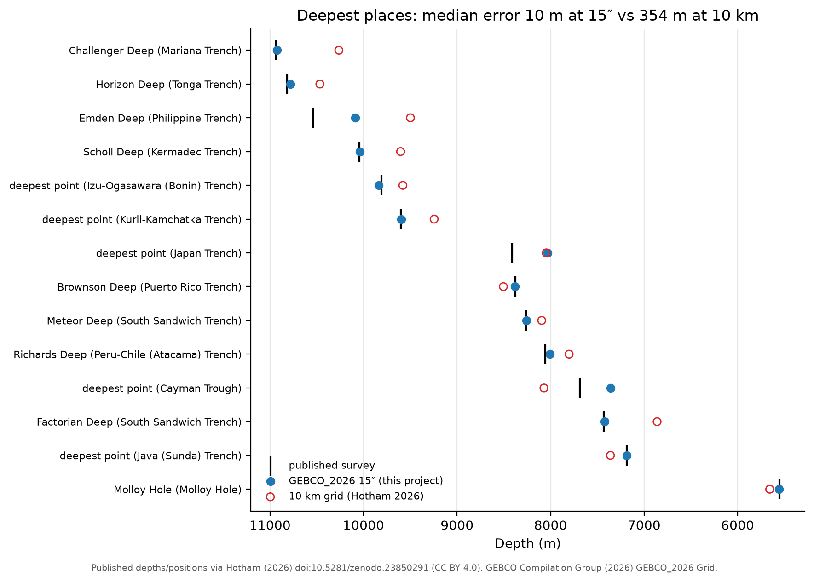

At 15″ the grid's deepest cell is within 10 m of the published depth at most of the 14 deepest places (Challenger Deep 10,927 vs 10,935 m). The large misses are where the source gives no position (Emden Deep, Japan Trench) or where the deepest cell was never measured (Cayman Trough). Table: [docs/trenches.md](docs/trenches.md).

### The north is mapped, the south is not; one year of progress

| By latitude and source | New in GEBCO_2026 |
|---|---|
| 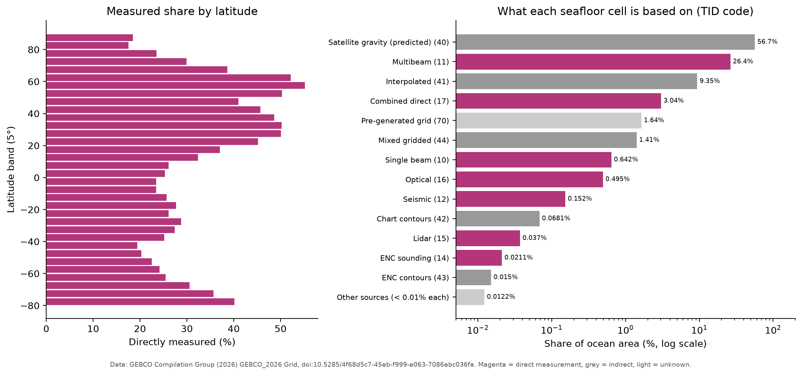 | 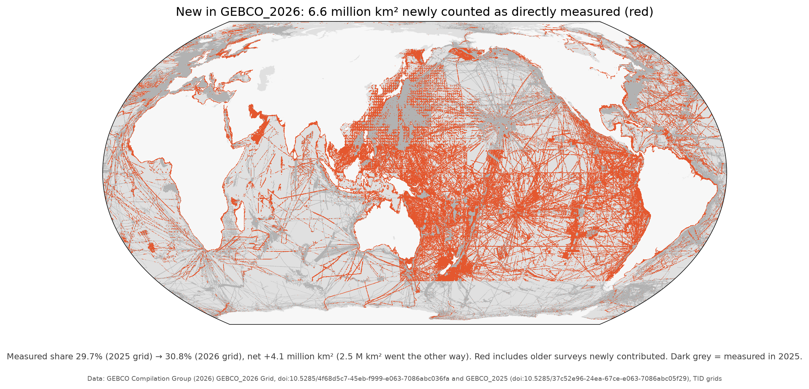 |

25–35° N and 50–65° N are about half measured; 40–50° S only 19–20 %. Between the 2025 and 2026 grids 6.6 million km² became "measured" and 2.5 million km² were re-coded the other way; the biggest gain is the Arabian Sea, matching the official ROPME report (6.4 % → 20.5 %).

### Whose waters are mapped

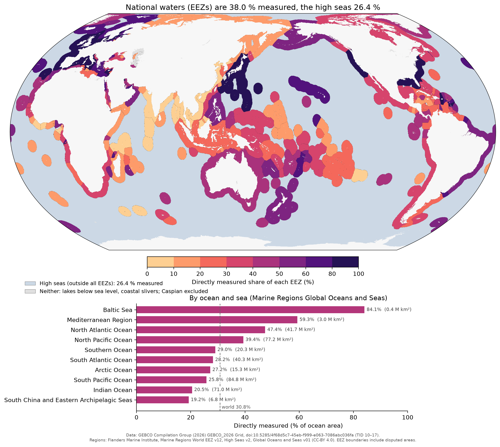

Western European EEZs are almost fully surveyed (France 99.9 %, Ireland 97.7 %); the Indian Ocean is the least measured ocean (20.5 %). This is what has been shared with GEBCO, not necessarily all that has been surveyed. Tables: [docs/regions.md](docs/regions.md).

### How sure is the depth where nobody measured?

| Two models disagree | Seals find deeper water |
|---|---|
| 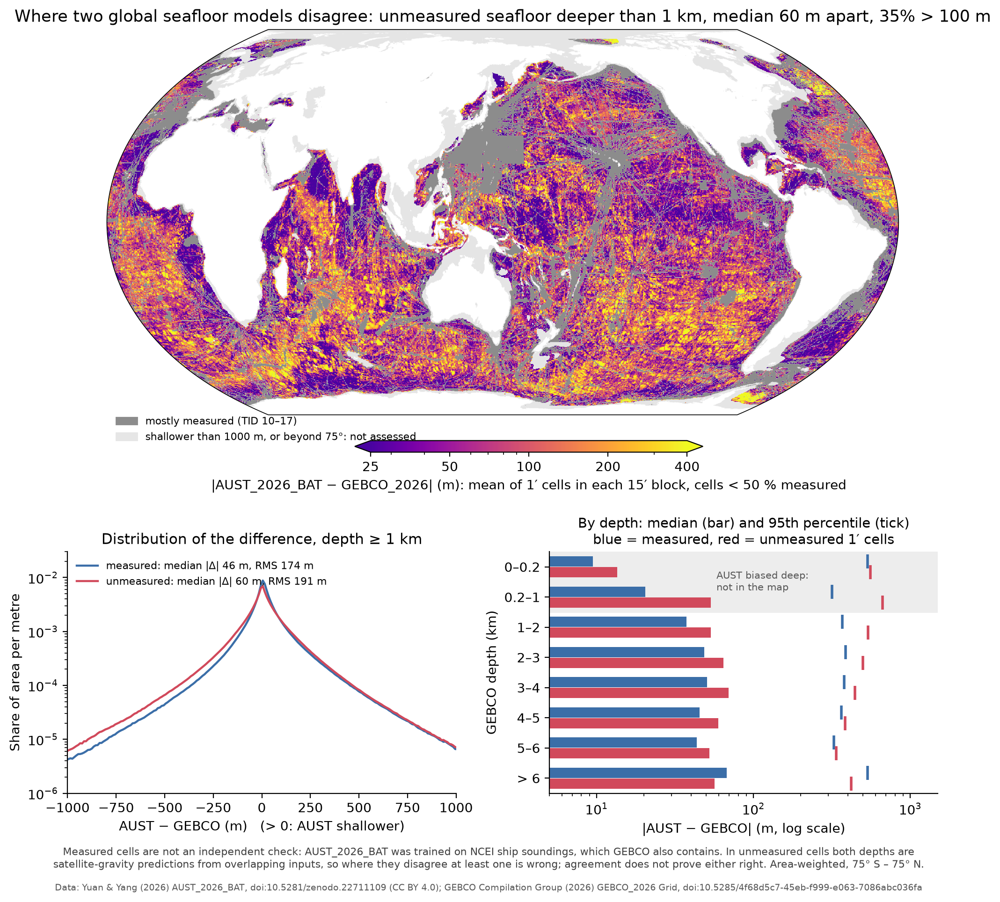 | 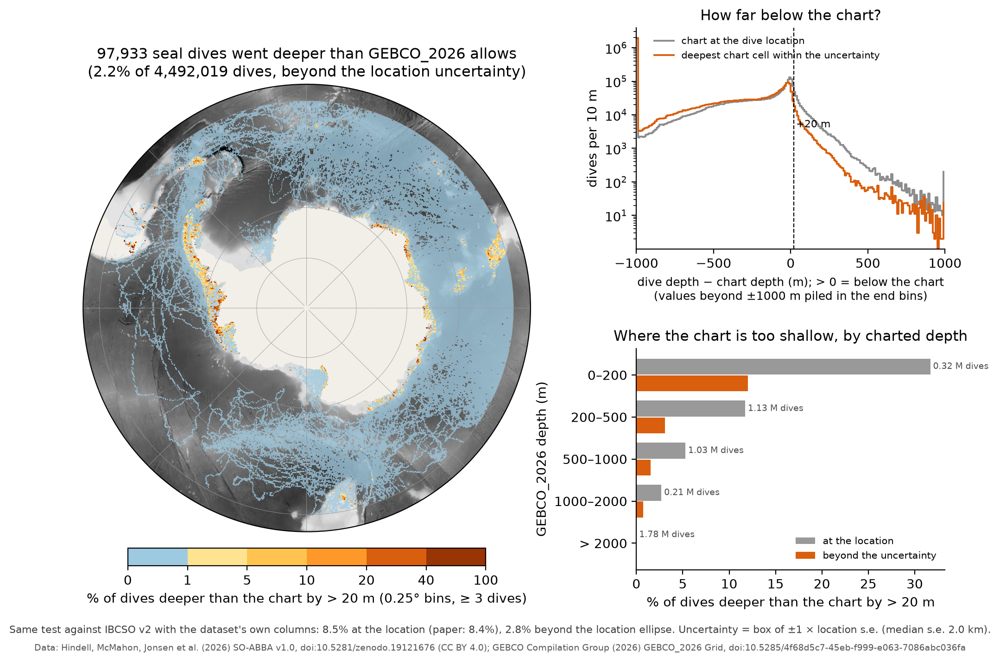 |

Where ships never went, GEBCO and an independent gravity + deep-learning model (AUST_2026_BAT) differ by a median of 60 m, and by more than 100 m over a third of that area. In the Southern Ocean, 97,933 seal dives went more than 20 m deeper than the chart allows even after allowing for position error, mostly on the Antarctic shelf.

### How far to the nearest measurement, and how wrong the predictions were

| Distance to the nearest measurement | Predicted vs later measured depth |
|---|---|
| 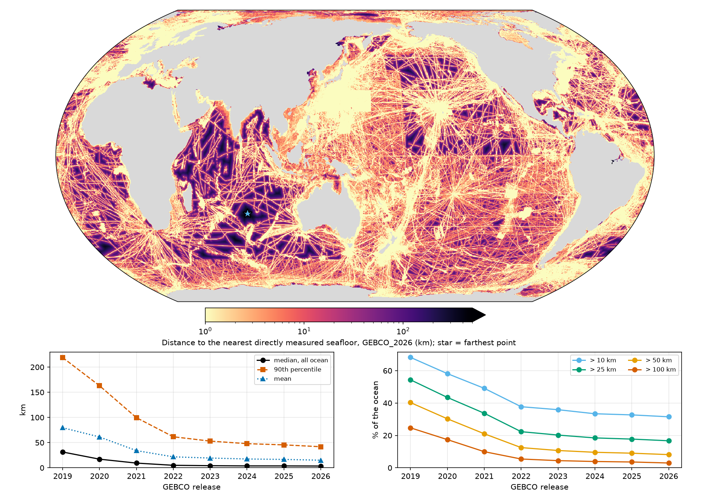 | 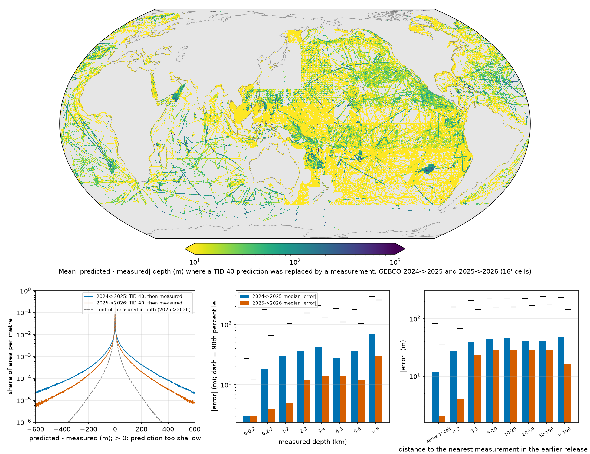 |

Half of the ocean floor is within 3.5 km of a measured cell in GEBCO_2026 (31.4 km in GEBCO_2019), but one cell in twelve (8.1 %) is more than 50 km away; the farthest deep point, in the central Indian Ocean, is 525 km from any measurement. Where a satellite-gravity prediction in GEBCO_2024 was replaced by a measurement in GEBCO_2025 (18.3 million cells), the prediction was off by a median 31 m and by more than 100 m in 22 % of the cells, and the error stops growing beyond about 5 km from earlier data. Details: [docs/distance.md](docs/distance.md), [docs/blindtest.md](docs/blindtest.md).

### The official figure and the shipping lanes

| Seabed 2030 rule applied to the TID grids | Unmeasured seafloor under ship tracks |
|---|---|
| 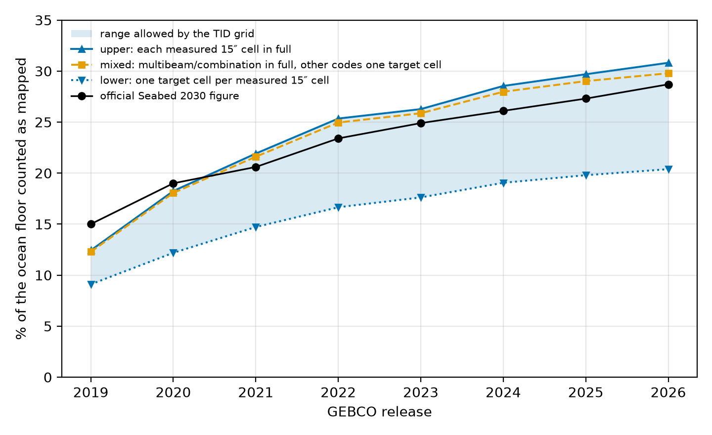 | 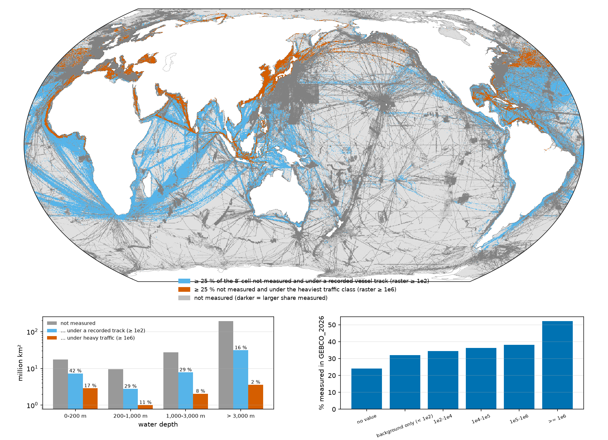 |

Applying the Seabed 2030 definition (one sounding per 100–800 m cell, by depth) to the public grids gives a range for each release. The official figures for 2021–2026 fall inside it (2026: 20.4–30.8 %, official 28.7 %); those for 2019 and 2020 lie above it, which the grids cannot explain. 19.7 % of the unmeasured seafloor (49.0 million km²) lies under at least one ship track recorded in 2015–2021. The World Bank / IMF traffic raster is weighted, not a count of positions, so the shipping layer is shown as relative intensity. Details: [docs/official_bracket.md](docs/official_bracket.md), [docs/shipping_gap.md](docs/shipping_gap.md).

### Where life is, and where nobody has looked

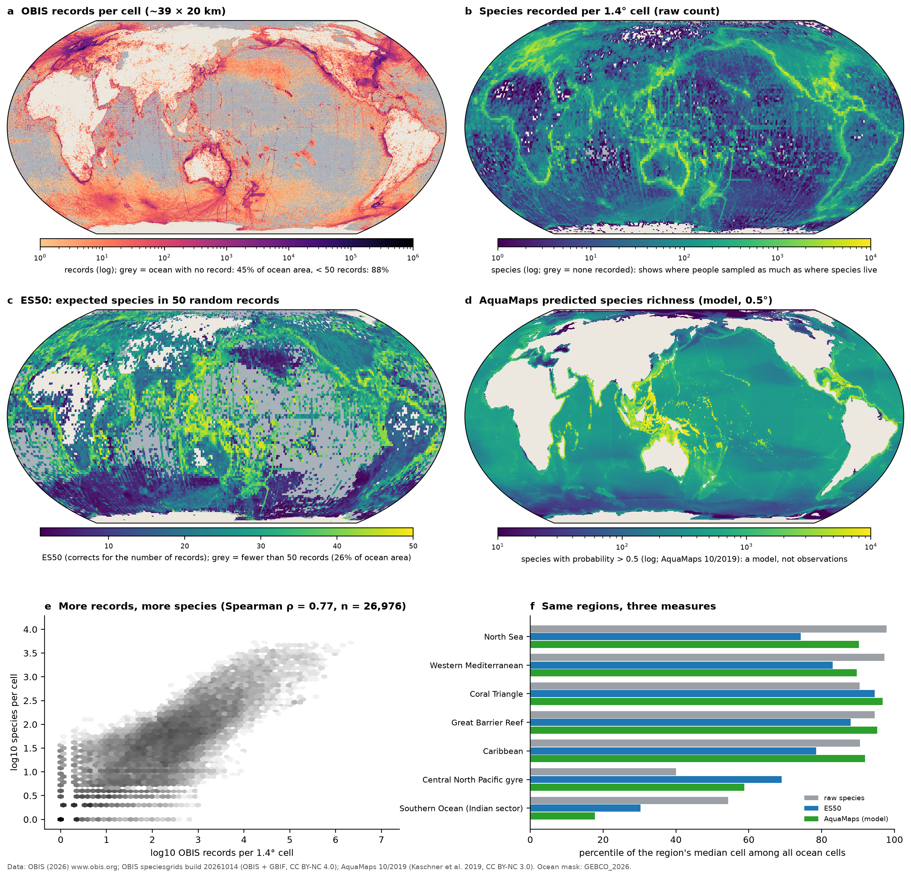

*Figure licence: CC BY-NC 4.0 (OBIS speciesgrids, AquaMaps).* Raw species counts mostly show where scientists sampled (records vs species ρ = 0.77). Corrected for sampling (ES50) and in the AquaMaps model, the Coral Triangle comes first while the North Sea drops from first to fifth. 45 % of the ocean has no species record at all at ~40 km resolution.

## How it is built

```
GEBCO_2026 elevation 15″ + TID ──► coverage.py, tiles.py (z0-5, Pages) ──┐
                                 └► tiles_hires.py (z6-7) ─► Hugging Face ─┤
GEBCO_2025 TID ──► change.py                                                │
WOA23 (NOAA) ──► woa.py ─► ocean water grids                                ├─► web/ (MapLibre GL globe)
AUST_2026_BAT, SO-ABBA, SWOT confidence ──► disagree.py, seals.py, uncertainty.py
OBIS, speciesgrids, AquaMaps ──► obis.py                                    │
World Bank AIS, Wikidata, TeleGeography, OpenStreetMap ──► shipping.py, wrecks.py, cables.py, offshore.py
Gazetteer, PB2002, Marine Regions ──► features.py, plates.py, regions.py ──┘
```

* **"Measured"** = GEBCO type codes 10–17 (sonar, lidar, soundings). **"Ocean"** = type ≠ 0 and below sea level.
* **Checks:** the COG mirror used for speed is identical to the official GEBCO server at 6 test sites; Challenger Deep reads −10,922 m at zoom 7 (official −10,927 m); the headline percentages are reproduced by two independent scripts; the viewer is tested in headless Chrome (90 checks: every layer, story, tool, deep link, phone layout, no console errors).
* **Tiles:** Web Mercator 512 px lossless WebP (depth as Terrarium RGB). Zoom 0–5 on Cloudflare Pages (GitHub Pages mirror); zoom 6–7 as PMTiles on [Hugging Face](https://huggingface.co/datasets/ismoilovdev/seafloor-atlas-tiles), read with HTTP range requests. Formats: [docs/data-contract.md](docs/data-contract.md). Prior work and how this differs: [docs/prior-work.md](docs/prior-work.md).
* **Visits** are counted with Cloudflare Web Analytics: no cookies, no personal data, no cross-site tracking.

## Run it

```bash
uv venv --python 3.12 .venv && uv pip install --python .venv/bin/python -r pyproject.toml
pipeline/fetch_data.sh                       # GEBCO, TID, plates (needs GDAL)
.venv/bin/python pipeline/coverage.py        # measured-share statistics
.venv/bin/python pipeline/tiles.py           # web tiles z0-5 (~10 min)
.venv/bin/python pipeline/figures.py         # README figures
.venv/bin/python -m pytest tests             # pipeline tests
cd web && npm ci && npm run dev              # viewer at http://localhost:5173
node scripts/qa.mjs http://localhost:4173/ qa-out     # browser QA against `npm run preview`
node scripts/readme_shots.mjs <url> ../docs/img       # regenerate the README screenshots
```

Every other layer has its own script in `pipeline/` (one per data source, each documented at the top).

## Keeping it up to date

* **Weekly (automatic):** `.github/workflows/refresh-data.yml` re-queries the OSM platforms, pipelines, wind farms and submarine cables (Overpass) and the Wikidata shipwrecks every Monday. Each new file is validated before it replaces the old one (schema, attribution, coordinates, feature count within ±20 %), only real changes are committed, then the site is redeployed.
* **Monthly (automatic):** `.github/workflows/release-watch.yml` checks for a new GEBCO grid, World Ocean Atlas, OBIS speciesgrids build or AquaMaps version and opens one issue with the rebuild checklist. Those rebuilds run locally.
* **Every deploy:** `pages.yml` warns above 750 MB and fails above 950 MB of built site (GitHub Pages limit 1 GB) and checks the Cloudflare Pages limits (20,000 files, 25 MiB per file).

What runs when, the manual checklists and how to roll back a bad data commit: [docs/maintenance.md](docs/maintenance.md).

### Site size

The built site is about 404 MB (2026-11-15: depth tiles 195 MB, coverage 51 MB, disagreement 42 MB, shipping 39 MB, ocean water 27 MB). When the guard warns, move the largest raster sets off Pages, the same way zoom 6–7 already live on Hugging Face:

1. pack each set into one archive: `.venv/bin/python pipeline/to_pmtiles.py web/public/tiles/disagree data/derived/pmtiles/disagree.pmtiles` (then `shipping`, `coverage`; non-tile files such as `legend.json` stay on Pages). The script reads every tile back and compares it byte for byte;
2. upload them to the dataset [ismoilovdev/seafloor-atlas-tiles](https://huggingface.co/datasets/ismoilovdev/seafloor-atlas-tiles) and pin the URLs to the upload commit, as `pipeline/publish_hires.py` does for `dem_z6-7.pmtiles`;
3. viewer change (not written yet): today `web/src/tilesource.ts` reads PMTiles only above zoom 5 and only for `dem`/`coverage`, so the moved layer needs an "archive for all zooms" path in `fetchTile` (and its source must go through the `sfa://` protocol); then remove the folder from `web/public/tiles/`;
4. run `npm test` and the browser QA, and check the size guard output in the Pages run.

### Performance on slow GPUs

Drawing the globe is limited by fill rate: the pixels drawn per frame grow with the square of the pixel ratio, and multisample antialiasing adds to that. `web/src/quality.ts` therefore caps the pixel ratio at 1.5 on touch screens and 2 elsewhere, antialiases only 1x screens, and lowers the pixel ratio in steps of 0.5 (down to 1) when the globe moves at under about 22 frames per second. Dragging the globe with a software GPU (SwiftShader, 2026-11-18):

| Screen | Before | After |
|---|---|---|
| phone, 390 × 844, pixel ratio 3 | 6.7 fps | 22.7–27.3 fps (pixel ratio 1.5) |
| desktop, 1440 × 900, pixel ratio 2 | 4.3 fps | 9.0 fps (stepped down to 1) |

`?pr=<ratio>` and `?aa=0|1` override both settings for comparisons.

## Limits

* Away from ship surveys the real detail is a few km (satellite gravity), so zooming in there shows smooth terrain.
* Poleward of 83° N/S the globe draws the relief from a separate polar grid (GEBCO_2026 15″ at 0.76 km per pixel, `tiles/polar/`), since Web Mercator tiles stop at 85.05°. The overlays (coverage, survey age, uncertainty and the rest) are Mercator tiles and stop at 85.05°.
* "Measured" cells are 460 m averages; one ship track through a cell counts it as measured.
* Cable routes are a 2022 snapshot (the open data is no longer updated; status as of 2022-11-14). The weekly OSM cable supplement adds mostly coastal chart cables: OSM rarely maps long-haul routes ([docs/cables-osm.md](docs/cables-osm.md)). Shipwrecks in Wikidata are mostly UK/Irish records; species records reflect sampling effort.
* The ocean mask includes the Caspian Sea and lake beds below sea level (0.93 million km², 0.26 % of the area); regional tables exclude the Caspian.

## Data and licences

| Data | Source | Licence |
|---|---|---|
| Seafloor elevation and type grid | GEBCO Compilation Group (2026) GEBCO_2026 Grid, [doi:10.5285/4f68d5c7-45eb-f999-e063-7086abc036fa](https://doi.org/10.5285/4f68d5c7-45eb-f999-e063-7086abc036fa) | OGL v3 |
| Undersea feature names | IHO-IOC GEBCO Gazetteer of Undersea Feature Names | cite |
| Plate boundaries | Bird (2003) PB2002, via fraxen/tectonicplates | ODC-By 1.0 |
| Oceans, EEZs, high seas | Flanders Marine Institute, Marine Regions (doi:10.14284/542, 10.14284/632, 10.14284/696) | CC BY 4.0 |
| Ocean water | World Ocean Atlas 2023, Locarnini et al. 2024 (doi:10.25923/54bh-1613), Reagan et al. 2024 (doi:10.25923/70qt-9574) | open (NOAA) |
| Deepest-place reference depths | Hotham (2026), [doi:10.5281/zenodo.23850291](https://doi.org/10.5281/zenodo.23850291) | CC BY 4.0 |
| Second seafloor model | Yuan & Yang (2026) AUST_2026_BAT, [doi:10.5281/zenodo.22711109](https://doi.org/10.5281/zenodo.22711109) | CC BY 4.0 |
| Seal dives | Hindell, McMahon, Jonsen et al. (2026) SO-ABBA, [doi:10.5281/zenodo.19121676](https://doi.org/10.5281/zenodo.19121676) | CC BY 4.0 |
| Prediction confidence | Nilsson, Phrampus et al. (2025), [doi:10.5281/zenodo.17673974](https://doi.org/10.5281/zenodo.17673974) | CC BY 4.0 |
| Marine life | OBIS (2026) www.obis.org; OBIS speciesgrids (OBIS + GBIF); AquaMaps 10/2019 (Kaschner et al. 2019, aquamaps.org) | cite; CC BY-NC 4.0; CC BY-NC 3.0 |
| Shipping density | World Bank / IMF (Cerdeiro, Komaromi, Liu & Saeed 2020) | CC BY 4.0 |
| Shipwrecks | Wikidata | CC0 |
| Submarine cables | TeleGeography Submarine Cable Map, snapshot 2022-11-14 | CC BY-NC-SA 3.0 |
| Platforms, pipelines, wind farms, OSM submarine cables; land mask for polders in the coverage tiles | © OpenStreetMap contributors | ODbL |
| Satellite land (streamed while the switch is on, not stored or redistributed) | Esri World Imagery (Source: Esri, Vantor, Earthstar Geographics, and the GIS User Community) | Esri terms of use; "Powered by Esri" shown under the readout |

**Code: MIT. Data and figures keep their source licences**: per-file table in [LICENSES.md](LICENSES.md). Some layers are non-commercial (CC BY-NC, CC BY-NC-SA) or ShareAlike (ODbL); the site is non-commercial. Depths are not for navigation; data is provided as is.

## Cite

Ismoilov, O. (2026). *Seafloor Atlas: an interactive globe of the whole ocean floor and how much of it has been measured* (v1.3.0). Zenodo. [doi:10.5281/zenodo.24287662](https://doi.org/10.5281/zenodo.24287662). All versions: [doi:10.5281/zenodo.24228190](https://doi.org/10.5281/zenodo.24228190). Please also cite the data sources above.
