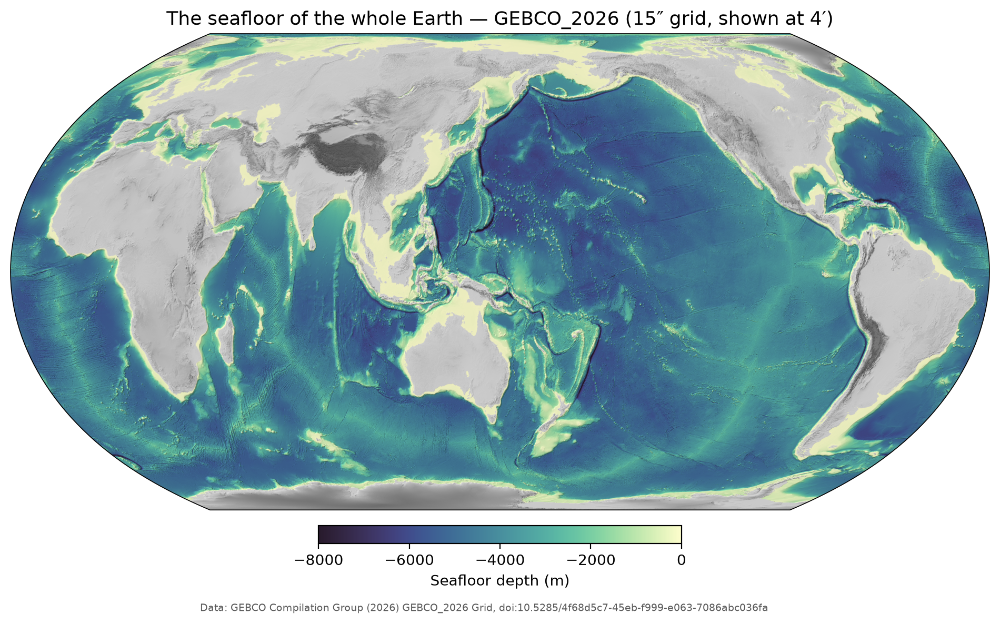
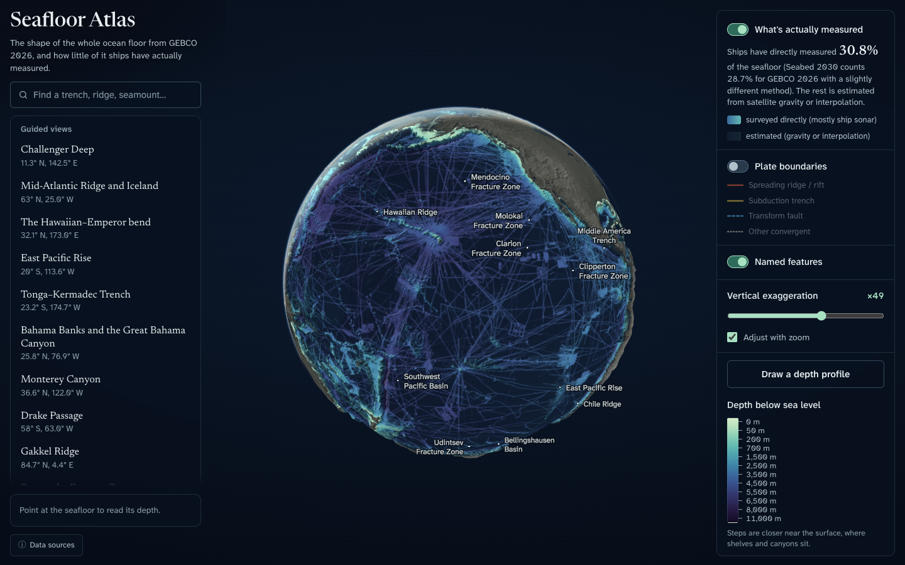
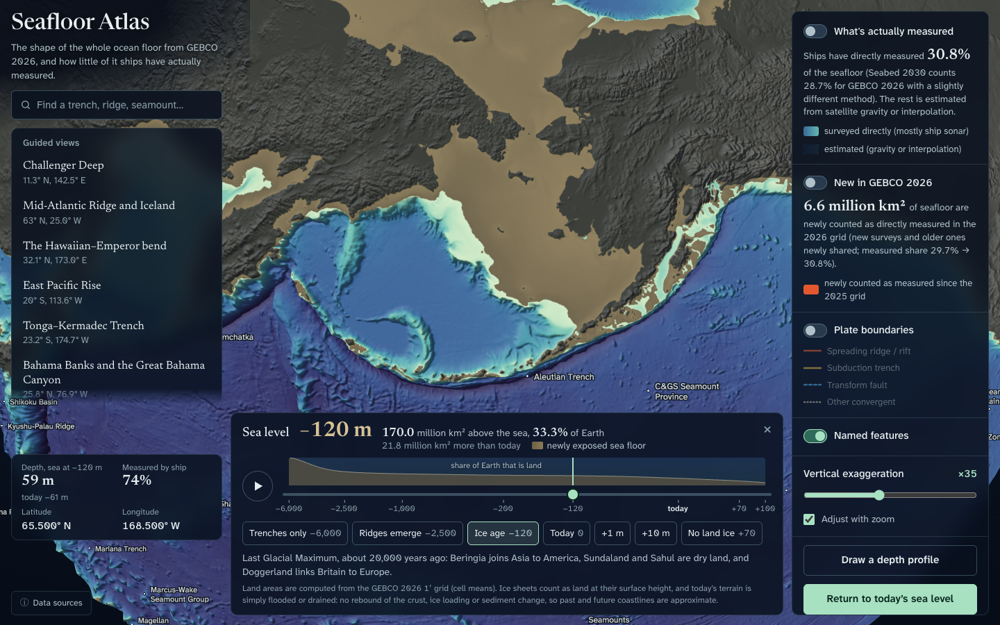
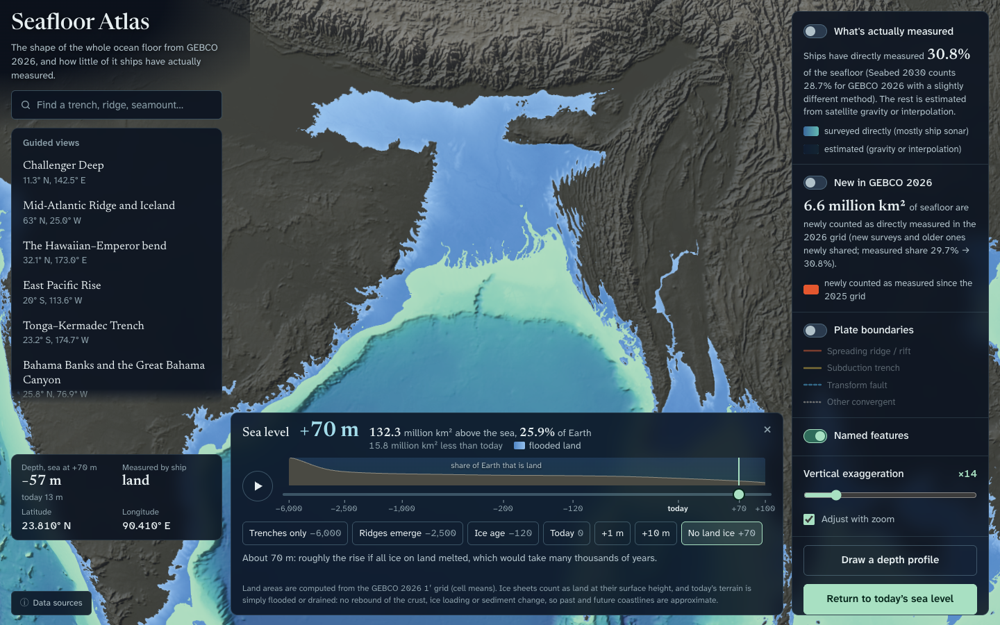

# Seafloor Atlas

A map of the whole Earth's ocean floor, built from the open **GEBCO_2026** grid. It also shows **which parts of the seafloor were actually measured by ships** and which were only estimated from satellites.



## Interactive globe

**Open it: https://ismoilovdevml.github.io/seafloor-atlas/**


* Rotate and zoom the whole seafloor in 3D (depth exaggerated so trenches and ridges are visible from space).
* **What's actually measured:** switch it on and the estimated seafloor goes dark, so you see only what ships have surveyed.
* **Depth profile:** click two points and get the depth along the line (here: across Challenger Deep, 227 km, deepest −10,721 m).
* **Guided views:** 11 places such as Challenger Deep, the Hawaiian–Emperor bend, the Mid-Atlantic Ridge and the MH370 search area.
* **Search** 5,412 named undersea features; **plate boundaries** with spreading rates.
* **Change sea level** from −6,000 m to +100 m, with an animation and presets: at the ice-age −120 m, Beringia, Sundaland, Sahul and Doggerland are dry land and Earth has **21.8 million km²** more land than today; at +70 m (about all land ice melted) it has **15.8 million km²** less. Areas are computed from the 1′ grid (`pipeline/hypsometry.py`; today 148.2 million km², 29.0 % of Earth, ice surfaces counted as land).

| Measured vs estimated | Depth profile across the Mariana Trench |
|---|---|
|  |  |

| Sea level −120 m (last ice age): Beringia is dry land | Sea level +70 m (all land ice melted): Bengal delta flooded |
|---|---|
|  |  |

Runs in the browser with no server and no tracking. Built with MapLibre GL; code in [web/](web/).

## Key numbers

| | |
|---|---|
| Ocean area | **361.7 million km²** (70.9 % of Earth) |
| Directly measured (ship sonar, lidar, …) | **30.8 %** = 111.4 million km² |
| Estimated from satellite gravity | **56.7 %** |
| Interpolated or other indirect | **10.8 %** |
| Source unknown | **1.6 %** |
| Deepest point on the grid | **Challenger Deep, −10,927 m** (15″ grid) |

All numbers are computed in this repo from the GEBCO_2026 Type Identifier (TID) grid, weighted by real area on the sphere. The official Seabed 2030 figure for GEBCO_2026 is **28.7 %**. Ours is 2.1 points higher because we count every 15″ cell (~460 m) with a direct measurement, while Seabed 2030 also requires a depth-dependent minimum resolution ("mapped to modern standards").

## What the data shows

### 1. Less than a third of the seafloor has been measured


The dark lines are single ship tracks. The solid dark areas are full multibeam surveys: around Japan, the North Atlantic, the US coasts, Australia and New Zealand. Everything in light grey has never been touched by a sonar. Its depth comes from small bumps in sea-surface gravity measured by satellites, which only resolve features of a few kilometres.

### 2. The deepest places are the best known, the "average" seafloor is the least known


* Most of the ocean floor (74 %) lies between 3 and 6 km deep. Only **28 %** of that range is measured. The 4–5 km abyssal plains are the worst at **26.7 %**.
* The trenches below 7 km are **94 %** measured, because expeditions target them.
* Continental shelves (0–250 m) are **31 %** measured in this grid. Many national shelf surveys are not shared publicly.

### 3. The north is mapped, the Southern Hemisphere is not


The 25–35° N and 50–65° N bands are about **50–55 %** measured (busy shipping lanes, Europe, North America, Japan). The 40–50° S band, under the Southern Ocean's storms, is only **19–20 %**. Multibeam sonar alone accounts for 26.4 % of the ocean; satellite-gravity prediction (code 40) covers 56.7 %.

### 4. What changed in one year (GEBCO_2025 → GEBCO_2026)


Comparing the two TID grids with the same ocean mask:

| | GEBCO_2025 | GEBCO_2026 |
|---|---|---|
| Directly measured | 29.7 % (107.4 M km²) | 30.8 % (111.4 M km²) |

* **6.6 M km²** became "directly measured" (63 % of it was satellite-gravity estimate in 2025), **2.5 M km²** went the other way (re-coded, mostly back to code 40). **Net +4.1 M km²**, close to the official "+5 M km² in a year".
* The largest gain is the **Arabian Sea and Gulf of Oman** (10–30° N, 50–70° E), which matches the official note that ROPME Sea Area coverage rose from 6.4 % to 20.5 %.
* Red includes older surveys that were newly shared with GEBCO, not only new expeditions. The viewer has this as the "New in GEBCO 2026" layer.

### 5. Whose waters are mapped


| | Measured |
|---|---|
| National waters (all EEZs, 139.6 M km²) | **38.0 %** |
| High seas (outside every EEZ, 221.1 M km², 61 % of the ocean) | **26.4 %** |
| Best: Baltic Sea / Mediterranean / North Atlantic | 84.1 % / 59.3 % / 47.4 % |
| Worst: Indian Ocean / South China and Eastern Archipelagic Seas | 20.5 % / 19.2 % |

Western European EEZs are almost fully surveyed (France 99.9 %, Ireland 97.7 %, Portugal 97.2 %). Several large EEZs in South and East Asia are under 7 % in this public grid. That is what has been *shared with GEBCO*, not necessarily what has been surveyed. Full tables, method and caveats: [docs/regions.md](docs/regions.md).

## What it is useful for

* **Science and education:** see plate tectonics directly. Mid-ocean ridges, trenches, fracture zones and hotspot seamount chains are all visible on one globe.
* **Planning surveys:** the coverage layer shows where a ship's transit would add new data (grey areas).
* **Tsunami, cable and pipeline context:** seafloor slope and depth along any route, via the depth-profile tool in the viewer.
* **Fisheries and habitat:** seamounts, canyons and shelf edges are where marine life concentrates.
* **Honest maps:** any "seafloor map" you see online shows the same picture, but rarely says that ~70 % of it is an estimate. This one does.

## How it is built

```
GEBCO_2026 elevation (15″, 1′ overview)  ─┐
GEBCO_2026 TID grid (15″, official CEDA)  ─┼─ pipeline/coverage.py ── stats.json + coverage grid
                                           │
                                           ├─ pipeline/tiles.py ───── web tiles (Terrarium DEM + coverage veil)
GEBCO Gazetteer (5,412 names) ─────────────┼─ pipeline/features.py ── features.geojson
PB2002 plate boundaries (Bird 2003) ───────┴─ pipeline/plates.py ──── plates.geojson
                                              pipeline/figures.py ─── figures/*.png
```

* **Elevation** comes from a Cloud-Optimised GeoTIFF mirror of the official grid (Source Cooperative), so only the 1′ level (~140 MB) needs to be downloaded instead of 7.5 GB. `pipeline/verify_mirror.py` checks the mirror against the official GEBCO server cell by cell at 6 sites (Challenger Deep, Mid-Atlantic Ridge, Hawaii, SE Indian Ocean, North Sea, Himalaya). Result: **all 6 windows identical** for elevation and TID; the 1′ level is the mean of each 4 × 4 block of 15″ cells (max difference 0.8 m, rounding).
* **"Measured"** = TID codes 10–17 (single beam, multibeam, seismic, soundings, lidar, optical). **"Ocean"** = TID ≠ 0 *and* elevation below sea level. Without the elevation test, the Antarctic ice sheet (2.7 % of Earth) would count as ocean.
* **Tiles:** Web Mercator, 512 px, lossless WebP, depth as Terrarium RGB in whole metres. Zoom 0–5 (1′ source) are static files on GitHub Pages; zoom 6–7 (15″ source, 1.8 GB + 0.2 GB) are PMTiles archives on Hugging Face, read with HTTP range requests (`pipeline/tiles_hires.py`, `pipeline/publish_hires.py`). Checked: Challenger Deep reads −10,922 m at zoom 7 (official 15″ grid −10,927 m) vs −10,675 m at zoom 5; zoom-6 tiles averaged down agree with the zoom-5 tiles to a median of 1–2 m. See [docs/data-contract.md](docs/data-contract.md).

## Run it

```bash
uv venv --python 3.12 .venv && uv pip install --python .venv/bin/python -r pyproject.toml
pipeline/fetch_data.sh                    # inputs (~470 MB, needs GDAL)
.venv/bin/python pipeline/coverage.py     # stats + coverage grid   (~1 min)
.venv/bin/python pipeline/tiles.py        # web tiles              (~10 min)
.venv/bin/python pipeline/tiles_hires.py  # zoom 6-7 PMTiles from the 15" grid (~70 min, 4.6 GB input)
.venv/bin/python pipeline/publish_hires.py # upload to Hugging Face, pin URLs in meta.json
.venv/bin/python pipeline/features.py     # undersea feature names
.venv/bin/python pipeline/plates.py       # plate boundaries
.venv/bin/python pipeline/hypsometry.py   # land area vs sea level for the viewer (~5 s)
.venv/bin/python pipeline/change.py       # 2025 -> 2026 comparison (needs the 2025 TID grid)
.venv/bin/python pipeline/tiles.py --only new2026
.venv/bin/python pipeline/figures.py      # README figures
.venv/bin/python pipeline/regions.py      # per-ocean and per-EEZ tables + fig6 (fetches Marine Regions)
.venv/bin/python -m pytest tests          # encoding tests
cd web && npm ci && npm run dev           # viewer at http://localhost:5173
```

## Limits

* Zoom 0–5 comes from the 1′ grid (~1.85 km). Zoom 6–7 comes from the full 15″ grid (~460 m) and is streamed from [Hugging Face](https://huggingface.co/datasets/ismoilovdev/seafloor-atlas-tiles) as PMTiles. Away from ship surveys the real detail is still only a few km (satellite gravity), so zooming in there shows smooth terrain.
* Beyond 85.05° N/S (outside Web Mercator) the globe shows a flat cap at the mean depth of the polar grid.
* The depth axis of figure 3 uses the 1′ cell mean, which smooths narrow trenches (Challenger Deep reads −10,900 m at 1′ vs −10,927 m at 15″).
* Even "measured" cells are a 460 m average. A single ship track crossing a cell marks it as measured.
* The ocean mask (TID ≠ 0 and below sea level) also includes the Caspian Sea and lake beds below sea level (Dead Sea, deep parts of Baikal and the Great Lakes), about 0.15 % of the ocean area. The regional tables exclude the Caspian.

## Data and licences

* GEBCO Compilation Group (2026) **GEBCO_2026 Grid**, doi:[10.5285/4f68d5c7-45eb-f999-e063-7086abc036fa](https://doi.org/10.5285/4f68d5c7-45eb-f999-e063-7086abc036fa). Open Government Licence v3.
* **IHO-IOC GEBCO Gazetteer of Undersea Feature Names**, www.gebco.net.
* Flanders Marine Institute: Global Oceans and Seas v1 (doi:10.14284/542), Maritime Boundaries / EEZ v12 (doi:10.14284/632), High Seas v2 (doi:10.14284/696). CC BY 4.0.
* Bird, P. (2003) An updated digital model of plate boundaries, *G³* 4(3), 1027. Via [fraxen/tectonicplates](https://github.com/fraxen/tectonicplates), ODC-By 1.0.
* Code: MIT. Prior work and how this differs: [docs/prior-work.md](docs/prior-work.md).
